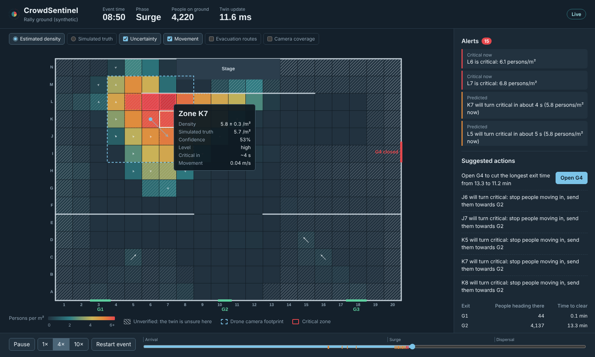
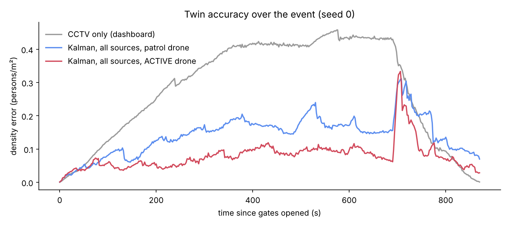

# CrowdSentinel

A real-time crowd safety digital twin for a police control room. It fuses CCTV, drone, cell-tower and WiFi data into one live map of crowd density, shows **where the twin itself is unsure**, sends the drone to its biggest blind spot, and warns officials before a zone turns critical.



## Why

Crowd crushes keep happening at rallies, festivals and concerts, including at events watched by AI cameras. Camera dashboards count people where cameras point, but crushes often start where nobody is looking. CrowdSentinel treats those blind spots as a first-class problem.

## What is new here

1. **Uncertainty-aware twin.** One Kalman filter over every zone of the venue keeps a density *and* a confidence. Uncertainty grows wherever no sensor has looked recently. The dashboard draws it as hatching, like unsurveyed land on an old map.
2. **Active drone guidance.** Every 10 s the drone is sent to the spot where *uncertainty × possible risk* is highest, discounted by travel time.
3. **Multi-source fusion.** Every source, real or simulated, becomes the same record: *these zones hold N people, with this variance*. Swapping a simulated feed for a real one needs no change to fusion.

## Results (5 simulated rallies, 4,000 people each)

| | CCTV-only dashboard | CrowdSentinel |
| --- | --- | --- |
| Density error, all zones (persons/m²) | 0.280 | **0.077** (−73%) |
| Density error, zones with no camera | 0.348 | **0.083** (−76%) |
| Dangerous zones (≥ 4/m²) caught | 19% | **87%** |
| Zones that turned critical and were detected | 3 of 25 | **25 of 25**, ~69 s early on average |

Active drone guidance cut the error in no-camera zones by **49%** compared with a fixed patrol route. Full tables, ablations and honest limitations: [experiments/results/results.md](experiments/results/results.md).



## How it works

```
 CCTV   Drone   Cell tower   WiFi   Road traffic
   \      |         |         |        /
    Ingestion adapters  ->  (zones, people, variance, time)
                    |
             Fusion engine (Kalman filter over all zones)
                    |
     Twin state: density, movement, confidence per 5 m zone  ->  SQLite history (replay)
        |              |               |                |
   Blind spots     Risk score      Prediction      Evacuation routes
   (drone goes)  (density+pressure) (1-2 min ahead) (gates, clearance time)
        \______________|_______________|________________/
                 Control-room dashboard (WebSocket, every 2 s)
```

| Folder | What it does |
| --- | --- |
| `simulation/` | Social-force crowd simulation of a rally (the ground truth), simulated sensors, traffic adapter |
| `vision/` | DM-Count density model, optical flow, camera-to-ground homography, real video adapter |
| `twin/` | Fusion engines, risk, prediction, blind spots and drone guidance, evacuation routing |
| `backend/` | FastAPI server: live loop, WebSocket, replay history |
| `dashboard/` | Control-room web page (plain HTML, CSS and JavaScript, canvas map) |
| `experiments/` | Every experiment from the evaluation plan, and the results |
| `tests/` | Automated tests (`python -m pytest -q`) |

## Run it on Windows

You need Python 3.10 or newer ([python.org](https://www.python.org/downloads/), tick *Add python.exe to PATH* while installing).

1. Open the `CrowdSentinel` folder in File Explorer, click the address bar, type `powershell` and press Enter.
2. Run the one-time setup (creates a virtual environment and installs packages):
   ```
   .\setup.bat
   ```
3. Start the control room:
   ```
   .\run_dashboard.bat
   ```
   Then open http://localhost:8000 in your browser. The first start simulates the rally (about 5 minutes) unless `data/scenarios/rally_seed0.npz` is already there.
4. Run the tests: `.\.venv\Scripts\python -m pytest -q`
5. Re-run all experiments (about 15 minutes, generates the other 4 scenarios first):
   ```
   .\.venv\Scripts\python -m simulation.generate --seeds 1 2 3 4
   .\.venv\Scripts\python -m experiments.run_experiments
   ```

### Optional: real video (vision module)

```
.\.venv\Scripts\pip install -r requirements-vision.txt
```
Download DM-Count weights (`model_sha.pth`) from https://github.com/cvlab-stonybrook/DM-Count into `vision/weights/`, then:

- Annotate a crowd video: `.\.venv\Scripts\python -m vision.run_video --video data\raw\crowd.mp4`
- Measure accuracy on ShanghaiTech: `.\.venv\Scripts\python -m vision.evaluate_density --root data\raw\ShanghaiTech\part_A`
- Feed a real camera into the twin: `vision/camera_source.py` (`VideoCameraSource`), calibrated with 4 image-to-ground points.

## Honest limitations

- **Simulated data.** Ground truth, cell-tower and WiFi feeds come from the crowd simulation. Real tower or WiFi data needs telecom and venue partnerships. The vision module runs on real video, but the density model has not yet been benchmarked in this repo (run `vision/evaluate_density.py`).
- **One venue, one camera layout.** The cameras deliberately leave the stage's front-left uncovered, as real venues have blind spots. Results depend on this layout.
- **Simple prediction.** Warnings come from a smoothed density trend: about 1 minute of warning, with 41% alarm precision. A forecast that runs the crowd simulation forward from the live state is the next step.
- **Sudden changes.** When the crowd suddenly starts leaving, the twin lags for about a minute (visible in the error plot).
- **Cell towers did not improve accuracy** in this layout when cameras and the drone were working. They help when cameras fail.
- **Decision support only.** The system suggests actions; officers decide. It counts people and measures movement, with no face recognition.

## References

- Helbing & Molnár (1995), Social force model for pedestrian dynamics.
- Helbing, Johansson & Al-Abideen (2007), Dynamics of crowd disasters: an empirical study (crowd pressure).
- Wang et al. (2020), Distribution Matching for Crowd Counting (DM-Count), NeurIPS.
- Fruin (1971) and Still (2014), crowd density levels of service.
